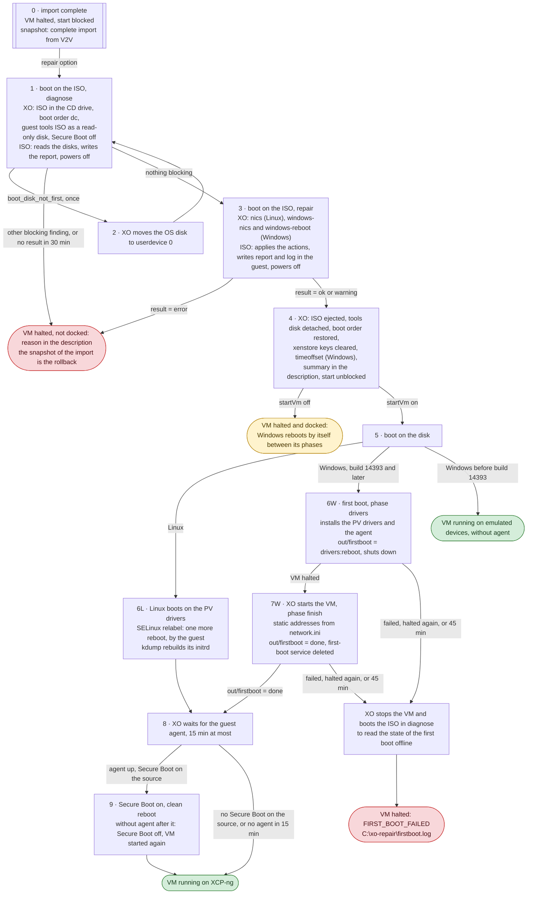

VMs Auto-pilot docking prepares a VM migrated from VMware to boot on XCP-ng, before its guest OS ever
boots there. It is made of two parts:

- **a live ISO**, built from this folder: booted in the migrated VM, it inspects the guest disks and
  applies offline what the guest needs on XCP-ng (Xen PV drivers in the initramfs, VMware tools
  disabled, XCP-ng guest tools installed, network configuration carried over…), then powers the VM
  off. It runs inside the target VM, so it sees the real XCP-ng virtual hardware;
- **the orchestration in xo-server** (`packages/xo-server/src/xo-mixins/vmware/`), enabled by the
  `repair` option of the import from VMware, and `startVm` to follow the first boot.

XO and the ISO talk through `VM.xenstore_data`: XO writes the inputs before booting the ISO, the ISO
writes its state and a compact report, see [xenstore contract](#xenstore-contract).

### Life cycle of a migrated VM

Each step is a state of the VM, each transition the condition XO waits for. The VM boots 2 to 3 times
on the ISO, then once on its disk for Linux and twice for Windows (plus one reboot to enable Secure
Boot again, when the source had it).



Boot by boot:

| Boot | On   | Started by                                    | What runs                                                                                                               | Ends with                                                                    |
| ---- | ---- | --------------------------------------------- | ----------------------------------------------------------------------------------------------------------------------- | ---------------------------------------------------------------------------- |
| 1    | ISO  | XO                                            | `diagnose`: read-only inspection, planned actions, blocking findings, `rtc_timeoffset` and network of Windows           | power off by the ISO                                                         |
| 1b   | ISO  | XO                                            | `diagnose` again, only after XO moved the OS disk first (`boot_disk_not_first`)                                         | power off by the ISO                                                         |
| 2    | ISO  | XO                                            | `repair`: the planned actions, in order; full report and log written in the guest                                       | power off by the ISO                                                         |
| 3    | disk | XO (`startVm`) or the administrator           | Linux: the guest itself, SELinux relabel if scheduled. Windows: phase `drivers` of the first boot, PV drivers and agent | Linux: running. Windows: shut down (`windows-reboot=xo`) or reboot (`guest`) |
| 4    | disk | XO (`windows-reboot=xo`), the guest otherwise | Windows only: phase `finish`, static addresses reapplied, first-boot service deleted                                    | running, `out/firstboot = done`                                              |
| 5    | disk | XO (`VM.clean_reboot`)                        | only when the source had Secure Boot and the pool has its UEFI certificates                                             | running, agent reporting                                                     |

A failed docking never fails the import: the data is there, and the snapshot taken at the end of the
import is the rollback. The VM description carries a summary of each run and of the first boot.

### Limits

The VM is imported but not docked, and left halted, when:

- the import is partial: the source was running and `Stop source` was not set. The task says so, the
  VM can be docked once a later import completes it;
- no docking ISO is deployed in an ISO SR of the pool (`REPAIR_ISO_NOT_FOUND`);
- its system volume is encrypted (LUKS, BitLocker);
- it is a Windows before 7 SP1 / 2008 R2 SP1, on dynamic disks, hibernated, with Fast Startup, or not
  cleanly shut down;
- no Linux or Windows is found on its disks (BSD...).

Except for the partial import, the reason is also written in the VM description.

It is docked, with less than a full migration, when:

- it is a Windows before build 14393: no PV drivers and no management agent;
- it is a Windows with several NICs whose source did not report its addresses (not running, or without
  VMware Tools): its static addresses are not carried over, the adapters use DHCP;
- the source had Secure Boot: it is enabled again only when XO follows the first boot (`startVm`);
- the guest is in [partially supported](#partially-supported).

Only imports from VMware use it.

### Supported guests

"Validated" means: installed on ESXi 8 with the VMware defaults (PVSCSI or LSI SAS, vmxnet3 or
e1000e, open-vm-tools / VMware Tools), imported with XO, docked by the ISO, then booted on XCP-ng with
no manual step. The guest runs on PV disk and NIC, and XO gets the OS, the agent version, the memory
and the IP addresses.

#### Fully supported

| Family      | Validated                                                                  | Initramfs                 | Guest agent                      | Network configuration                 |
| ----------- | -------------------------------------------------------------------------- | ------------------------- | -------------------------------- | ------------------------------------- |
| Debian      | 13 (BIOS, UEFI)                                                            | initramfs-tools           | `.deb`                           | ifupdown                              |
| Ubuntu      | 22.04 (UEFI), 24.04 (BIOS), 26.04 desktop (UEFI)                           | initramfs-tools           | `.deb`                           | netplan, NetworkManager               |
| RHEL family | CentOS 7.3, Rocky 8.10, 9.8, 10.2, Oracle Linux 9.8 (UEK and RHCK kernels) | dracut                    | `.rpm`                           | ifcfg, NetworkManager                 |
| SUSE        | SLES 16.0, openSUSE Leap 15.6 (BIOS, UEFI), SLES 15 SP7 (UEFI)             | dracut                    | `.rpm`                           | NetworkManager, wicked                |
| Arch        | rolling (BIOS)                                                             | mkinitcpio (experimental) | generic `.tgz`                   | systemd-networkd                      |
| Windows     | Server 2016, 2019, 2022, 2025                                              | n/a                       | PV drivers 9.x, management agent | captured, reapplied by the first boot |

Configurations validated across these guests: BIOS and UEFI, Secure Boot off on the source, SELinux
enforcing (relabel), btrfs with snapper, LVM over three disks with the root LV spanning two, `/boot`
and `/usr` each on their own disk, fstab by UUID, by `dm-uuid` and by YaST device ID, two NICs with
static addresses on both (Linux, and Windows Server 2022 with `windows-nics`: each address on its VIF,
DNS queries seen on the first one), Windows static address with its DNS reapplied by the first boot
(Server 2019 and 2022), DHCP (Ubuntu 22.04 gets the same address on XCP-ng as on VMware: same MAC,
same lease), kdump enabled.

RHEL itself is not tested (no subscription on the test bench): Rocky Linux and Oracle Linux (RHCK
kernel) share its kernel, dracut, rpm and NetworkManager; the RHEL subscription is left untouched.

#### Partially supported

| Guest                                                                                          | What works                                                                                                                                                                                          | What is missing                                                                                                                                                                                                                                                                                                 |
| ---------------------------------------------------------------------------------------------- | --------------------------------------------------------------------------------------------------------------------------------------------------------------------------------------------------- | --------------------------------------------------------------------------------------------------------------------------------------------------------------------------------------------------------------------------------------------------------------------------------------------------------------- |
| Windows before build 14393: 7 SP1, 8.1 and Server 2012 R2 validated, 2008 R2 expected the same | Offline changes; the VM boots on the emulated IDE disk and the emulated NIC (inbox driver), with the VMware MAC: DHCP and MAC reservations keep working, a static IP is reapplied by the first boot | The XCP-ng 9.x PV drivers do not support these versions (`pv_drivers_unsupported`): by default the first boot installs no package. No PV drivers, no management agent, so no `out/firstboot` in xenstore and XO does not follow the first boot: its state is only readable offline (`diagnose`, `os.firstboot`) |
| Transactional systems with a read-only root (SL Micro 6.2)                                     | Nothing is written offline. The VM boots on PV devices when its initramfs already has the Xen drivers, which the ISO checks (`initramfs_xen_drivers_present`, true for the generic SL Micro image)  | The guest agent and the other offline changes are listed in `readonly_root`, to do after the first boot with `transactional-update`. An initramfs without the Xen drivers is blocking (`readonly_root_initramfs`): rebuild it on the source first                                                               |
| Linux with neither systemd nor a package manager supported by the guest tools                  | Initramfs, fstab, VMware tools, network                                                                                                                                                             | No guest agent (`guest_agent_unsupported`): install it after the first boot                                                                                                                                                                                                                                     |
| Linux without systemd-udevd                                                                    | Initramfs, fstab, VMware tools, agent                                                                                                                                                               | Interface names are not pinned (`linux_interface_names`)                                                                                                                                                                                                                                                        |
| Linux with a kernel without `xen-blkfront`                                                     | Boots on the emulated IDE disk (`no_xen_blkfront`)                                                                                                                                                  | No PV disk                                                                                                                                                                                                                                                                                                      |

#### Not supported

- Windows before 7 SP1 / 2008 R2 SP1 (`unsupported_windows_version`).
- Encrypted system volume, LUKS root or BitLocker on the Windows volume: the ISO has no key, so it
  reports the volume (`luks_volume`, `bitlocker_volume`) and finds no system to change
  (`no_os_found`, blocking). Decrypt it on the source before the migration. An encrypted data volume,
  next to a system in clear, is reported and left untouched: the guest is docked, the volume itself is
  not tested.
- Windows dynamic disks, hibernated Windows or Fast Startup: blocking.
- Windows volume not cleanly shut down (`ntfs_unclean`, blocking): the source was powered off, or
  imported while running and then powered off. ntfs-3g only mounts such a volume read-only, so nothing
  could be written. The source must be shut down from the guest (VMware Tools, which `Stop source`
  does), not powered off.
- Anything else (BSD, ...): `no_os_found`.

### What the ISO does

Detection never modifies anything: it records findings and plans actions, each with a stable `code`.
`repair` applies them in order. Non-critical actions only produce a warning when they fail.

#### All Linux guests

| Action       | Code                        | What it does                                                                                                                                                                                                                                                                                                                                                                                                                                                                                                                                                                                                                                    |
| ------------ | --------------------------- | ----------------------------------------------------------------------------------------------------------------------------------------------------------------------------------------------------------------------------------------------------------------------------------------------------------------------------------------------------------------------------------------------------------------------------------------------------------------------------------------------------------------------------------------------------------------------------------------------------------------------------------------------- |
| Initramfs    | `initramfs_xen_drivers`     | Rebuilds it with the guest's own tool in a chroot, with `xen-blkfront`, `xen-netfront` and the emulated IDE drivers. Critical: a PVHVM kernel unplugs the emulated disks at boot whenever it has blkfront support, so without the module in the initramfs the root disk disappears                                                                                                                                                                                                                                                                                                                                                              |
| fstab        | `fstab_stable_names`        | Rewrites `/dev/sdX`, and hardware `by-id` / `by-path` names of the root disk, to `UUID=`. In place (inode and SELinux label kept), backup in `fstab.xo-repair.bak`. Content-derived names (`dm-uuid-`, `lvm-pv-uuid-`, `md-uuid-`) are stable and left alone                                                                                                                                                                                                                                                                                                                                                                                    |
| VMware tools | `disable_vmware_tools`      | Disables the open-vm-tools / vmware-tools units (`vmtoolsd`, `vgauth`, `vgauthd`). Masked units are left alone                                                                                                                                                                                                                                                                                                                                                                                                                                                                                                                                  |
| Network      | `linux_pin_interface_names` | Interface names change on XCP-ng (`ens192` → `enX0`). For each old name found in the network configuration, writes `/etc/systemd/network/10-xo-repair-<name>.link`, which gives the name back to the NIC with the same MAC, before the initramfs is rebuilt. The guest configuration (ifupdown, ifcfg, NetworkManager, netplan, networkd) then applies unchanged. Automatic with one NIC; with several, XO passes `nics`. Kernel names (`eth0`) do not change. The network configuration itself is never modified: static and DHCP interfaces stay as they are, and a DHCP reservation by MAC keeps working since the VIFs keep the VMware MACs |
| Guest agent  | `install_guest_agent`       | When neither `xe-guest-utilities` nor `xen-guest-agent` is there, installs `xe-guest-utilities` from the [guest tools disk](#guest-tools-disk) and enables `xe-linux-distribution` (not started)                                                                                                                                                                                                                                                                                                                                                                                                                                                |
| kdump        | `kdump_initrd_rebuild`      | Deletes the kdump initrd built on VMware without `xen-blkfront`; kdump rebuilds it on XCP-ng at the next boot. Without this, the capture kernel does not find the disk                                                                                                                                                                                                                                                                                                                                                                                                                                                                          |
| SELinux      | `selinux_relabel`           | When SELinux is enabled and anything was changed, schedules a relabel (`/.autorelabel`), which may cost one extra reboot                                                                                                                                                                                                                                                                                                                                                                                                                                                                                                                        |

#### Per family

- **Debian, Ubuntu**: initramfs-tools (`update-initramfs -u -k all`, modules appended to
  `/etc/initramfs-tools/modules`). Agent: the `.deb`, installed with `dpkg -i` under a temporary
  `policy-rc.d` that forbids starting services: in a chroot, `invoke-rc.d` would otherwise start the
  daemon on the live system.
- **RHEL family** (RHEL, CentOS, Rocky, Alma...): dracut (`--add-drivers`, per kernel). Agent: the
  `.rpm` (`rpm -U`; the scriptlets enable the unit and `systemctl` starts nothing in a chroot), or the
  `legacy` `.rpm` with `chkconfig` when there is no systemd. kdump: `/boot/initramfs-*kdump.img`,
  rebuilt by `kdumpctl`.
- **SUSE** (SLES, openSUSE): dracut. Root on btrfs with snapper: the default subvolume is mounted,
  `subvol=` options of fstab are honoured. fstab by device ID (YaST "mount by device ID", older SLES)
  is rewritten when it names the root disk: its entry tells which VMware name is that disk, and the
  partitions follow. kdump: `/var/lib/kdump/initrd`, rebuilt by `mkdumprd`. Agent: the `.rpm`.
- **Arch and other systemd guests without dpkg or rpm**: mkinitcpio (drop-in
  `/etc/mkinitcpio.conf.d/90-xo-repair.conf`, `mkinitcpio -P`), reported as experimental. Agent: the
  generic `.tgz`, extracted by the ISO following the guest's own links (`/usr/sbin` → `usr/bin`), with
  the systemd unit of the guest tools ISO.
- **Transactional systems** (SL Micro, root on a read-only btrfs snapshot, or `/` mounted `ro` in
  fstab with `transactional-update` present): the root is never written offline. Instead of
  rebuilding the initramfs, the ISO lists it (`lsinitramfs`) and checks that `xen-blkfront` and
  `xen-netfront` are in it for every kernel.

#### Windows (7 SP1 / 2008 R2 SP1 and later)

Offline, from the ISO, in every control set so that "Last Known Good Configuration" boots too. The
SYSTEM hive is backed up as `SYSTEM.xo-repair.bak` before being written (`commit_registry`).

| Action          | Code                      | What it does                                                                                                                                                                                                                                                                                                                                                                                                                                                                                                                                                                                                                                                           |
| --------------- | ------------------------- | ---------------------------------------------------------------------------------------------------------------------------------------------------------------------------------------------------------------------------------------------------------------------------------------------------------------------------------------------------------------------------------------------------------------------------------------------------------------------------------------------------------------------------------------------------------------------------------------------------------------------------------------------------------------------- |
| Boot drivers    | `enable_ide_boot`         | `atapi`, `intelide`, `pciide` start at boot, `StartOverride` removed, so Windows boots from the emulated IDE disk                                                                                                                                                                                                                                                                                                                                                                                                                                                                                                                                                      |
| VMware services | `disable_vmware_services` | Disables them (Start=4), found by name and by rule (image path under `\VMware\VMware Tools\`, or a `vm*` kernel driver described as VMware). Conservative: other VMware/Broadcom products (Carbon Black...) are left alone                                                                                                                                                                                                                                                                                                                                                                                                                                             |
| Network         | `clear_old_static_ip`     | Captures the TCP/IP configuration of the old PCI adapters in the report (`network`), then switches the ones with a static address to DHCP; otherwise Windows refuses the same address on the new adapter. Adapters already in DHCP are left untouched. The new PV adapter starts in DHCP with the VMware MAC, so a DHCP reservation by MAC applies to it as before. The static configuration (addresses, masks, gateways, DNS) is written to `\xo-repair\network.ini` for the first boot, keyed by the MAC of the VIF: automatic with a single static adapter on a single NIC, from `windows-nics` otherwise (`windows_static_ip_unmapped` when an adapter has no MAC) |
| First boot      | `install_firstboot`       | Installs the temporary service `XoRepairFirstboot` and `\xo-repair\` (`firstboot.ps1`, `config.ini`), and copies the packages matching `windows-msi-patterns` from the guest tools disk into `\xo-repair\packages\`                                                                                                                                                                                                                                                                                                                                                                                                                                                    |

Also reported: `os.rtc_timeoffset` (seconds, which XO sets as `platform:timeoffset`: Windows keeps the
RTC in local time and XCP-ng starts it at UTC), the state of a previous first boot (`os.firstboot`,
`windows_firstboot_incomplete` with the end of its log), and `pv_drivers_unsupported` below build 14393. Below that build, the default `windows-msi-patterns` is empty: the XCP-ng 9.x MSI would fail and
stop the first boot in its `drivers` phase, before `finish` reapplies the static IP. Patterns given
explicitly by XO are always used.

##### Windows first boot

`firstboot.ps1` runs at each boot as LocalSystem until its phases are done, then deletes its service.
It is compatible with PowerShell 2.0. Before any phase, it restricts `C:\xo-repair` to SYSTEM and the
administrators (written through ntfs-3g, it is writable by every user), and removes the `Run` entries
that start a program from `\VMware\VMware Tools\` ("VMware User Process"), which crashes without its
services.

| Phase     | `standard` | `full` | What it does                                                                                                                                                                                                                                                                         | Ends with       |
| --------- | ---------- | ------ | ------------------------------------------------------------------------------------------------------------------------------------------------------------------------------------------------------------------------------------------------------------------------------------ | --------------- |
| `drivers` | yes        | yes    | installs the packages matching `windows-msi-patterns` from `\xo-repair\packages\`, in order, then tries the VMware Tools MSI uninstall                                                                                                                                               | reboot          |
| `cleanup` |            | yes    | removes VMware driver packages from the driver store (`pnputil -f -d`, provider read from the INF), the VMware Tools directories, and the VMware-signed `vm*.dll` / `vm*.sys` / `pvscsi.sys` from System32                                                                           | reboot          |
| `finish`  | yes        | yes    | applies `network.ini` to the adapters with these MACs (WMI `EnableStatic`, `SetGateways`, `SetDNSServerSearchOrder`). `full` only: removes the ghost VMware PCI devices (vendor 15AD) with `pnputil /remove-device`, on Windows 10 2004 / Server 2022 and later. Then reports `done` | service deleted |

With `windows-reboot=xo`, each reboot of the table is a shut down instead (`shutdown /s`): XO, which
follows the first boot, starts the VM again. Before the PV drivers are loaded the guest cannot tell it
anything, so a stopped VM is the signal. Once they are loaded, the script also writes
`<phase>:reboot` before shutting down. The default, `guest`, is for a VM started by hand: it must never
be left stopped in the middle of its first boot. XO sets `xo` when it follows the first boot
(`startVm`) and the PV drivers support the guest.

A failing phase is retried at the next boot, up to 3 attempts, then the script gives up
(`<phase>:failed`) and deletes its service. The log is in `\xo-repair\firstboot.log`, next to the MSI
installation logs.

`standard` is the default and non-destructive: the VMware components stay on disk, disabled. `full`
follows [vmwremover](https://github.com/virtio-win/vmwremover), except that vsock is kept (removing it
means editing the Winsock catalog) and devcon.exe is not used (not redistributable): ghost devices stay
where pnputil cannot remove them, which is harmless since the old static addresses were cleared.

#### UEFI (all guests)

The NVRAM on XCP-ng is new, so the boot entries created on VMware are lost. The ISO does not write
NVRAM: it makes sure `\EFI\BOOT\BOOTX64.EFI` exists on the ESP (`efi_fallback_loader`). For Linux it
copies shim, GRUB and grub.cfg from the vendor directory, like `grub-install --force-extra-removable`;
for Windows, `bootmgfw.efi`.

#### Detected but not changed

- **Interface names that could not be pinned**: several NICs without `nics`, or no systemd-udevd
  (`linux_interface_names`).
- **Unstable device names left**: hardware by-id/by-path names of other disks than the root one
  (`fstab_unstable_names`), `resume=` or `root=` with such a name in `/etc/default/grub`
  (`grub_unstable_resume`, `grub_unstable_root`): the initramfs waits for that device at every boot.
- **Firmware mismatches** (Windows on GPT with BIOS, UEFI without ESP).
- **OS not on the first disk** (`boot_disk_not_first`, blocking: nothing is modified). XCP-ng boots
  the first disk, so such a VM does not boot. XO moves the VBD of `data.os_disk` to `userdevice` 0 and
  runs the ISO again. Validated with Debian 13 (data disk first, OS on the second disk).
- **Encryption, dynamic disks, hibernation**: see [not supported](#not-supported).

#### Left to the administrator

- **open-vm-tools / VMware Tools** stay installed, disabled (`standard` cleanup on Windows). Remove
  them when convenient.
- **Secure Boot**: off during the ISO runs (the ISO is not signed). With `startVm`, XO turns it back on
  after the first boot if the source had it and the pool certificates are installed, and turns it off
  again if the VM does not boot with it: validated on Ubuntu 22.04, SLES 16.0 and Windows Server 2022.
  Without `startVm`, enable it again once the VM has booted.
- **SCC / RHN registrations**: not tested.

### XO side

The orchestration is the [life cycle](#life-cycle-of-a-migrated-vm) above. Details that matter:

- **The ISO** is the most recent `vates-autopilot-docking-*.iso` (by name, which starts with the build date and time) of an
  ISO SR of the pool, inserted in the CD drive of the VM (created when it has none) and ejected after
  the runs. `REPAIR_ISO_NOT_FOUND` when there is none.
- **`platform:secureboot=false` is mandatory for every UEFI VM** on each boot on the ISO, even when XO
  shows `secureBoot: false`: an absent key means `auto` on XCP-ng 8.3. Symptom: the VM lands in the
  UEFI Shell (`Access Denied` on `\EFI\BOOT\BOOTX64.EFI`) and nothing appears in xenstore. A signed ISO
  would remove this.
- **`nics`** is built from the networks of the VMX, `ens<ethernetN.pciSlotNumber>=<MAC>` for each NIC:
  the predictable name the guest gave it on VMware (`pciSlotNumber` 192 → `ens192`). With it, a
  migration with several NICs needs no manual step.
- **`windows-nics`** matches the addresses the VMware tools reported while the source was running (MAC
  → addresses) with the `network` of the diagnose report (GUID → addresses). A Windows source with
  several NICs which reported nothing (not running, no VMware tools) keeps DHCP on all its adapters,
  with a warning.
- **Running the ISO again** (retry after a failure or a timeout) is safe and validated on Rocky 9 and
  Windows Server 2022: on Linux the agent is not reinstalled and fstab and the pinned names stay as
  they are (the initramfs is rebuilt and a relabel scheduled again); on Windows, a first boot that
  already ended in `done` with the PV drivers installed is not scheduled again
  (`windows_firstboot_already_done`). But the old adapters were switched to DHCP by the first run, so
  the second report has no static configuration in `network`: the `network` of the first report is the
  one to keep.
- **Stale keys**: `VM.xenstore_data` persists after the halt and `vm.set` merges keys, so before each
  boot on the ISO XO deletes every input it does not set and the whole `out/` subtree, and deletes all
  of them after the last run. Otherwise it may read a `done` from a previous run. The ISO also deletes
  `out/` when it starts, but too late to protect XO.
- **Timeouts**: 30 minutes for a run of the ISO, 45 minutes for the Windows first boot, 15 minutes for
  the guest agent to report after the first boot.

#### Not done by XO

- The fallback for the adapters left in `windows_static_ip_unmapped` (`VIF.configure_ipv4` /
  `VIF.configure_ipv6` once the agent is up, validated by hand on Windows Server 2019 with agent
  9.2.385: address and gateway applied within seconds, no DNS). They stay in DHCP, with a warning.
- `windows-cleanup=full`: XO always uses `standard`.
- Windows patches (`.msp`): `firstboot.ps1` runs `msiexec /i` on every package. Not needed with the
  current tools ISO (its `XenTools-fix-9.2.351.msp` targets 9.2.351, the MSI installs 9.2.385). If a
  future one needs it: `/p` by extension, after its MSI, 1642 (not applicable) as skipped.

#### Guest tools disk

The ISO takes the XCP-ng guest tools from the guest tools ISO every pool already has, so the docking
ISO stays generic and the tools match the host.

- **VDI**: the guest tools ISO of the pool (`VDI.is_tools_iso = true`, in the `XCP-ng Tools` SR); XAPI
  accepts a VDI of an ISO SR in a disk VBD.
- **VBD**: `type=Disk`, `mode=RO`, `userdevice=25` (`xvdz`) when free, `bootable=false`. Not a CD:
  xen-blkfront ignores CD drives on HVM guests, so the live system would not see it.
- **Recognition**: a whole disk with an `iso9660` or `udf` filesystem and a `Linux/` or `Windows/`
  directory. It is never taken as a guest disk.
- **Optional**: without it the report says `"tools": null`, Linux gets `guest_agent_missing` and
  Windows `windows_tools_disk_missing`; the Windows first boot then looks for the packages on a CD
  drive.

#### xenstore contract

Paths are relative to the domain (`/local/domain/<domid>/`).

Inputs, set by XO through `VM.xenstore_data` (keys must start with `vm-data/`):

| Key                                      | Values                                                                                                                                                                                                                              | Default                         |
| ---------------------------------------- | ----------------------------------------------------------------------------------------------------------------------------------------------------------------------------------------------------------------------------------- | ------------------------------- |
| `vm-data/xo-repair/mode`                 | `diagnose`, `repair`                                                                                                                                                                                                                | `diagnose`                      |
| `vm-data/xo-repair/windows-msi-patterns` | `;`-separated file patterns of the packages to install, in order (e.g. `xen-*.msi;managementagent-*.msi`)                                                                                                                           | `*.msi`, none below build 14393 |
| `vm-data/xo-repair/windows-cleanup`      | `standard` or `full`, see [Windows first boot](#windows-first-boot)                                                                                                                                                                 | `standard`                      |
| `vm-data/xo-repair/windows-reboot`       | `guest` or `xo`: who restarts the VM between the phases of the first boot, see [Windows first boot](#windows-first-boot)                                                                                                            | `guest`                         |
| `vm-data/xo-repair/nics`                 | Linux, `;`-separated `<old name>=<MAC>` (e.g. `ens192=00:0c:29:d4:bf:19;ens224=00:0c:29:d4:bf:23`). Only needed with several NICs                                                                                                   | unset                           |
| `vm-data/xo-repair/windows-nics`         | Windows, `;`-separated `<MAC>=<GUID>`: the VIF that gets the static configuration of the old adapter with this `guid` in `network` (e.g. `00:0c:29:94:80:0d={44FED271-EE81-4363-8CF0-893542F0734F}`). Only needed with several NICs | unset                           |
| `vm-data/xo-repair/keep-running`         | `1` to stay up after the run (debugging)                                                                                                                                                                                            | unset                           |

Outputs, written by the ISO under `vm-data/` too: XAPI syncs the guest's `vm-data/` subtree back into
`VM.xenstore_data`, but not `data/`.

| Key                               | Content                                                                                                                                                                                                                                                                                                |
| --------------------------------- | ------------------------------------------------------------------------------------------------------------------------------------------------------------------------------------------------------------------------------------------------------------------------------------------------------ |
| `vm-data/xo-repair/out/version`   | ISO version (`YYYYMMDD-<sha>` or the release tag)                                                                                                                                                                                                                                                      |
| `vm-data/xo-repair/out/mode`      | mode actually used                                                                                                                                                                                                                                                                                     |
| `vm-data/xo-repair/out/state`     | `running`, then `done` (written last: the other keys are final)                                                                                                                                                                                                                                        |
| `vm-data/xo-repair/out/result`    | `ok`, `warning` or `error`                                                                                                                                                                                                                                                                             |
| `vm-data/xo-repair/out/report`    | compact JSON report, written raw (`xenstore-write -R`)                                                                                                                                                                                                                                                 |
| `vm-data/xo-repair/out/firstboot` | Windows, written by the first-boot script once the PV drivers are loaded: `<phase>:running`, `<phase>:reboot` (`windows-reboot=xo`, the VM shuts down), `<phase>:error`, `<phase>:failed` or `done`. A later `diagnose` run reads it offline and writes it too (`<phase>:pending` if it never started) |

oxenstored refuses guest values over 2048 bytes (`quota-maxsize`), so the compact report is limited
to 1900 bytes: info-level findings, messages and details are dropped first, the `code` of each finding
and action and the `network` list are always kept. In repair mode the full report and the log are also
written into the guest: `/var/log/xo-repair/` on Linux, `\xo-repair\` on Windows.

```json
{
  "version": "20261012-1a2b3c4d",
  "mode": "diagnose",
  "result": "warning",
  "firmware": "uefi",
  "disks": ["xvda", "xvdb"],
  "tools": "xvdz",
  "os": {
    "kind": "linux",
    "name": "Debian GNU/Linux 12 (bookworm)",
    "id": "debian",
    "version": "12",
    "root": "/dev/xvda2",
    "kernels": ["6.1.0-18-amd64"],
    "initramfs": "initramfs-tools",
    "guest_agent": "xe-guest-utilities_7.30.0-19_amd64.deb"
  },
  "network": [],
  "findings": [
    { "level": "warning", "code": "linux_interface_names", "message": "...", "data": { "interfaces": ["ens192"] } }
  ],
  "actions": [{ "code": "initramfs_xen_drivers", "status": "planned", "description": "..." }]
}
```

For Windows, `network` lists the TCP/IP configuration of the old adapters (`adapter`, `vmware`,
`dhcp`, `addresses`, `masks`, `gateways`, `dns`).

### Troubleshooting

Look, in this order, at the description of the VM, the task of the import, then the files in the guest.
xenstore only helps while the ISO or the Windows first boot runs: XO deletes its keys after its runs.

#### The description of the VM

After each step, XO writes a summary below the line `--- V2V repair ---`: the text above the line is
kept, the next write replaces everything below it. For example, a Windows VM followed through its
first boot:

```
--- V2V repair ---
repair: ok
OS: Windows Server 2022 Standard (uefi)
actions:
- enable_ide_boot: applied
- disable_vmware_services: applied
- clear_old_static_ip: applied
- install_firstboot: applied
- commit_registry: applied
- efi_fallback_loader: applied
first boot: drivers phase done, VM restarted by XO
first boot: done
```

| Line                                                                     | Meaning                                                                                                                                               |
| ------------------------------------------------------------------------ | ----------------------------------------------------------------------------------------------------------------------------------------------------- |
| `repair: ok`, `warning` or `error`                                       | result of the `repair` run                                                                                                                            |
| `repair failed: <reason>`                                                | XO stopped, see the [error codes](#the-task-of-the-import)                                                                                            |
| `the guest was only diagnosed, nothing was changed in it`                | a blocking finding stopped it after `diagnose`: the guest is as imported                                                                              |
| `- <code>: <status> (<error>)` under `actions:`                          | `planned` (diagnose only), `applied`, `failed`, or `skipped` after a failed critical action. The codes are in [what the ISO does](#what-the-iso-does) |
| `- <level> <code>: <message>` under `findings:`                          | warnings and errors; an `error` is blocking                                                                                                           |
| `details were dropped from the report to fit in xenstore`                | the full report is in the guest                                                                                                                       |
| `first boot: <phase> phase done, VM restarted by XO`, `first boot: done` | Windows first boot followed by XO                                                                                                                     |
| `first boot failed: <reason>`                                            | the VM is stopped, see `C:\xo-repair\firstboot.log`                                                                                                   |

No `--- V2V repair ---` at all: docking was not requested, or the import is partial (the task says so).

#### The task of the import

Each run of the ISO is a subtask, `repair ISO: diagnose` or `repair ISO: repair`, whose log carries the
version of the ISO, the result, and the codes of the findings, actions and failures. A failure does
not fail the import: it is a warning of the task, `the guest could not be repaired: <message>` or
`the first boot on XCP-ng failed: <message>`, with one of these codes in the log of xo-server:

| Code                       | Meaning                                                                          | What to do                                                                                                                         |
| -------------------------- | -------------------------------------------------------------------------------- | ---------------------------------------------------------------------------------------------------------------------------------- |
| `REPAIR_ISO_NOT_FOUND`     | no `vates-autopilot-docking-*.iso` in an ISO SR of the pool                      | deploy the ISO, then import again                                                                                                  |
| `REPAIR_ISO_TIMEOUT`       | no result within 30 minutes: most often the firmware did not boot the ISO        | [run the ISO by hand](#running-the-iso-by-hand) and watch the console: the UEFI Shell with `Access Denied` means Secure Boot is on |
| `REPAIR_ISO_NO_RESULT`     | the VM halted without the ISO writing `done`, or without a report                | run the ISO by hand with `keep-running`, read `/run/xo-repair/xo-repair.log`                                                       |
| `REPAIR_OS_DISK_NOT_FOUND` | the ISO found the OS on a disk the VM does not have                              | check the disks of the VM                                                                                                          |
| `REPAIR_BLOCKED`           | a blocking finding in `diagnose`: nothing was changed                            | the finding is in the description, see [limits](#limits)                                                                           |
| `REPAIR_FAILED`            | the `repair` run failed: the guest may be partly changed                         | the files in the guest; revert to the snapshot of the import to start again                                                        |
| `FIRST_BOOT_FAILED`        | the Windows first boot did not end: XO stopped the VM and read its state offline | `C:\xo-repair\firstboot.log`                                                                                                       |

The snapshot of the import is `after complete import from V2V`, or `complete import from V2V` when the
source was stopped by the import (`Stop source`).

Warnings without failure: no guest tools ISO in the pool (no guest agent), static addresses not
carried over (`windows_static_ip_unmapped`), guest agent not reporting within 15 minutes of the first
boot, Secure Boot left off.

#### xenstore

XO deletes every `vm-data/xo-repair/` key before each run of the ISO and after the last one. After the
docking, only `vm-data/xo-repair/out/firstboot` can be there: the Windows first boot writes it once the
PV drivers are loaded, so it holds the last state it could report. From the pool master:

```sh
xe vm-param-get uuid=<VM UUID> param-name=xenstore-data param-key=vm-data/xo-repair/out/firstboot
```

During a run of the ISO, all the [outputs](#xenstore-contract) are there:
`xe vm-param-get uuid=<VM UUID> param-name=xenstore-data`.

#### The files in the guest

The report in xenstore is short on purpose (codes always, details when they fit). The details stay in
the VM: `repair` writes the full report and the full log of the ISO into the guest, next to what the
first boot produces. A `diagnose` run writes nothing.

| Guest   | Files                                                                                                                                                                                                             |
| ------- | ----------------------------------------------------------------------------------------------------------------------------------------------------------------------------------------------------------------- |
| Linux   | `/var/log/xo-repair/report.json`, `/var/log/xo-repair/xo-repair.log`; backups next to the changed files (`/etc/fstab.xo-repair.bak`, `/etc/initramfs-tools/modules.xo-repair.bak`)                                |
| Windows | `C:\xo-repair\report.json`, `xo-repair.log` (ISO), `firstboot.log` (first boot, each phase and the static IP configuration), `install-*.log` (MSI), `network.ini`; `SYSTEM.xo-repair.bak` next to the SYSTEM hive |

When the guest does not boot, reach them by [running the ISO by hand](#running-the-iso-by-hand) with
`keep-running`, or by attaching the disk to another VM.

#### Running the ISO by hand

To watch a run on the console, or to reach the disks of a guest which does not boot. On the pool
master, with the VM halted:

```sh
vm=<VM UUID>
# the CD drive XO created; without one: xe vm-cd-add uuid=$vm cd-name=<ISO name> device=3
xe vm-cd-insert uuid=$vm cd-name=<vates-autopilot-docking-....iso>
xe vm-param-set uuid=$vm HVM-boot-params:order=dc platform:secureboot=false
xe vm-param-set uuid=$vm xenstore-data:vm-data/xo-repair/mode=diagnose \
  xenstore-data:vm-data/xo-repair/keep-running=1
xe vm-start uuid=$vm
```

`diagnose` changes nothing in the guest; `repair` can be run again safely, see [XO side](#xo-side).
With `keep-running`, the console logs in as the live user (`user`, with `sudo`):
`/run/xo-repair/report.json` and `/run/xo-repair/xo-repair.log` hold the run, the guest disks can be
mounted, and `sudo xo-repair --mode diagnose --verbose` runs it again. A `diagnose` run also reads the
state of a Windows first boot offline (`os.firstboot`, with the end of `firstboot.log`).

Afterwards, shut the VM down, then put back what XO does after its runs:

```sh
xe vm-cd-eject uuid=$vm
xe vm-param-set uuid=$vm HVM-boot-params:order=c
xe vm-param-remove uuid=$vm param-name=xenstore-data param-key=vm-data/xo-repair/mode
xe vm-param-remove uuid=$vm param-name=xenstore-data param-key=vm-data/xo-repair/keep-running
# and each vm-data/xo-repair/out/ key listed by: xe vm-param-get uuid=$vm param-name=xenstore-data
```

Set `platform:secureboot=true` again if the guest used it.

### Modes

**`diagnose`** is the default. It only reads: filesystems are mounted read-only without journal
replay (`noload`, `norecovery`, `rescue=nologreplay`), and actions are reported as `planned`, which
shows exactly what `repair` would do.

**`repair`** applies the planned actions in order, unless a blocking error was found, in which case
nothing is modified. A failing critical action stops the run and the following actions are reported
as `skipped`.

### Layout

```
auto/config                      live-build options (Debian trixie, BIOS + UEFI hybrid ISO)
config/package-lists/            packages of the live system
config/hooks/normal/             enable the service; zero boot menu timeouts; boot menu titles
                                 (the default hooks of live-build are linked by `lb config`)
config/bootloaders/splash.svg    boot menu background (logo embedded in base64), 640x480 for
                                 isolinux, scaled to 800x600 for grub
config/includes.chroot/          files copied into the live system
  etc/systemd/system/xo-repair.service
  usr/local/bin/xo-repair
  usr/lib/xo-repair/xo_repair/   the tool (Python stdlib + python3-hivex)
scripts/build.sh                 build, check and version the ISO
scripts/check-iso.sh             post-build checks on the ISO
tests/                           unit tests (python3 -m unittest)
```

The tool depends only on Debian packages: no pip, no lockfile. Security updates come from rebuilding
the ISO.

### Build

On Debian trixie, as root, from this folder:

```sh
apt-get install live-build
scripts/build.sh               # produces dist/vates-autopilot-docking-<version>.iso and its .sha256
lb clean                       # auto/clean also removes generated config files
```

`scripts/build.sh` writes the version (`YYYYMMDDTHHMMSSZ-<sha>`, with `-dirty` if tracked files are modified,
or `YYYYMMDDTHHMMSSZ-$XO_REPAIR_VERSION`) into the ISO, then runs `lb config`, `lb build` and `scripts/check-iso.sh`.
The build needs a privileged container (live-build mounts chroots), e.g.
`podman run --rm --privileged -v "$PWD:/src" -w /src debian:trixie scripts/build.sh` after installing
live-build in it.

### Development

```sh
python3 -m unittest discover -s tests -v    # needs python3-hivex for the registry tests
```

The tool can also be run by hand from the live system, or from any Linux system with the guest disks
attached. Without `--service` it never powers off:

```sh
xo-repair --mode diagnose --verbose
cat /run/xo-repair/report.json /run/xo-repair/xo-repair.log
```

Kernel command line switches, for testing without XO: `xo-repair.mode=repair`,
`xo-repair.keep-running`, and `xo-repair.disable`, which skips the service. With `keep-running`, the
console logs in automatically as the live user (`user`, with `sudo`).
